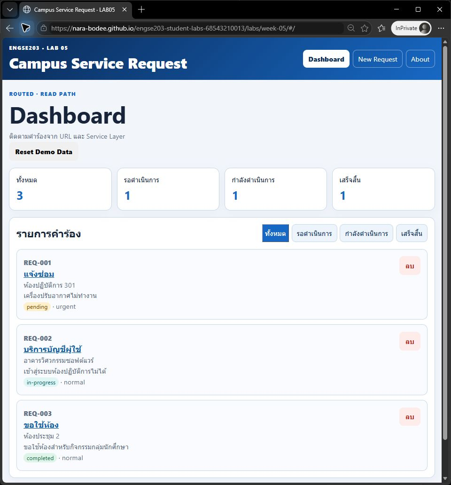
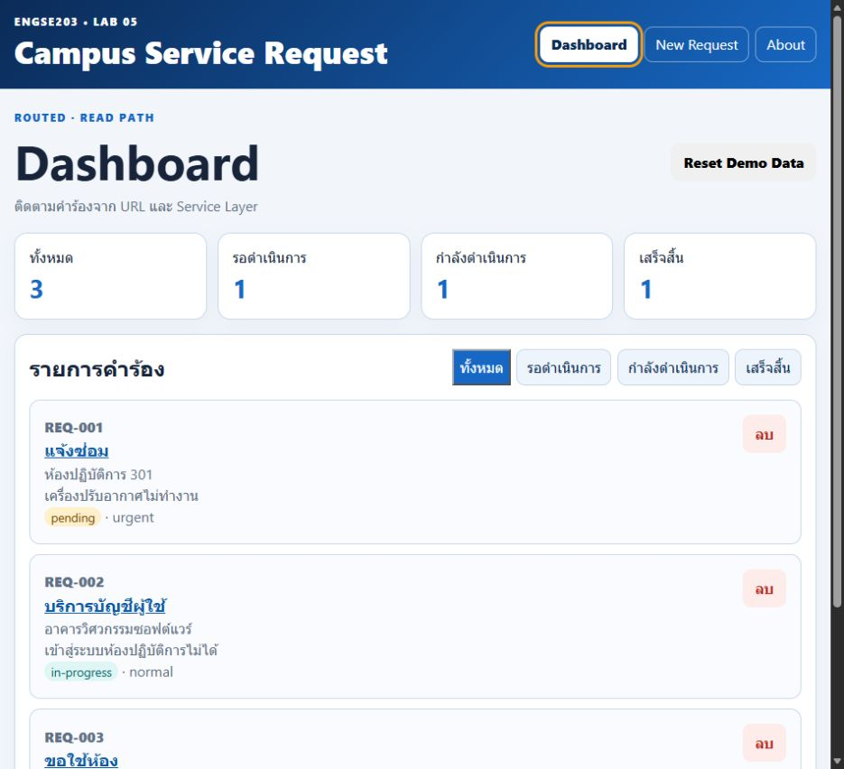
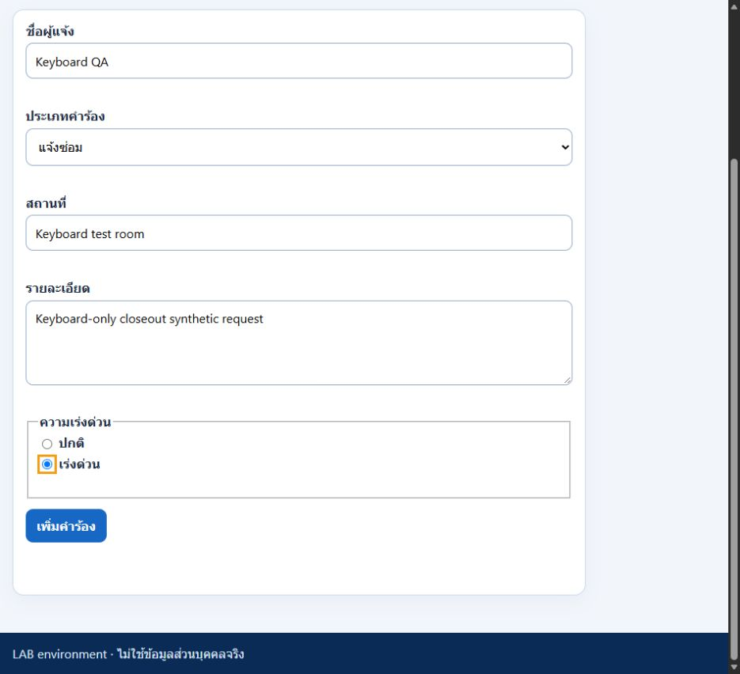

# ENGSE203 LAB05 — Post-audit test report

Test date: **2026-10-24, Asia/Bangkok**. Branch: `fix/week-05-v2`, based on audited main `91807ef3752608b8846188409e3a76f502fe249c`.
Tester: Codex automation, Windows. Initial checks used CUA in-app browser **normal context**; the screenshot followup used a genuine **Microsoft Edge InPrivate** native window. This is not a learner or peer attestation.
Node **22.23.4**, npm **12.2.0**, Vite **8.1.5**. Initial regression also ran on Node **24.19.0**.

The previous report and its 11 original image files are preserved byte-for-byte under [legacy-pre-audit](legacy-pre-audit/README.md). Its old PASS labels, dates, browser and commit do not describe this run. Historical `REGRESSION_CHECKLIST.md` was not rerun with its named peer or Safari browser.

## Automated verification

| Command in `labs/week-05/source` | Before guard | After guard |
|---|---|---|
| `npm run test:cleanup` | **FAIL: 3 passed, 14 failed / 17** | **PASS: 17/17**, Node22 and Node24 |
| `npm run check` (unchanged instructor checker) | Historical133/133 did not detect missing guards | **PASS: 133/133** |
| `npm run build` | Baseline fresh build PASS | **PASS**, Node22 and Node24 |

The regression harness transforms real page JSX with installed Vite/Oxc, injects controlled hooks and deferred service promises, and executes actual Effect callbacks. It is a **component callback harness**, not a React DOM renderer or browser E2E test. It covers both happy paths, resolve/reject after unmount, dependency change/reload/StrictMode setup, old rejection after new success, and old/current `onRecovery`. These same assertions failed before the fix. Browser checks complement them.

## Current results for all 24 original cases

PASS means the stated result was observed. WARNING means only part of the original multi-part case was verified. UNVERIFIED means the original requirement is unproved. TC18 includes three subcases but counts as one numbered case.

| Case | Status | Actual result and limits | Evidence |
|---|---|---|---|
| TC-L5-01 Dashboard | PASS | Seed3; summary3/1/1/1 | `images/dashboard-initial.png` |
| TC-L5-02 menu navigation | UNVERIFIED | Final closeout: navigation/active links passed in real revision GUI. Native DevTools Network inspection is blocked by pending Windows Security input; no claim of a completed no-HTML-reload check | FINAL_MANUAL_RESULTS.json; mandatory verification pending |
| TC-L5-03 new route refresh | PASS | Reload at `#/requests/new` retained New Request form, no404 | `BROWSER_EXTRA_OBSERVATIONS.json` |
| TC-L5-04 found detail | PASS | REQ-001 shows matching seed name, location, details/status | `images/route-detail-found.png` |
| TC-L5-05 missing record | PASS | REQ-999 shows missing-record detail and back link, not route404/error | `images/detail-missing.png` |
| TC-L5-06 unknown route | PASS | `#/unknown` shows NotFound plus header/footer/back link | `images/route-not-found.png` |
| TC-L5-07 first use | UNVERIFIED | Final closeout: actual DevTools envelope and key-removal check not completed because native input is blocked; initial first-use observation remains historical | FINAL_MANUAL_RESULTS.json; mandatory verification pending |
| TC-L5-08 loading | PASS | Real loading indicator before seed response; QA server delayed seed HTTP1500ms | `images/state-loading.png` |
| TC-L5-09 error | PASS | Test notice, friendly error, Retry; no stack trace rendered | `images/state-error-retry.png` |
| TC-L5-10 retry | PASS | Retry URL returned to `#/`;3 seed records loaded | `images/retry-success.png`, provenance URL |
| TC-L5-11 empty | PASS | Empty notice/no-record state/create link, not error | `images/state-empty.png` |
| TC-L5-12 checker | PASS | Unmodified checker133/133, exit0 | Dated command ledger |
| TC-L5-13 validation | PASS | Blank fields showed inline errors; `short` details showed minimum10-character message; no record added | `images/form-validation-error.png`, `BROWSER_EXTRA_OBSERVATIONS.json` |
| TC-L5-14 add/refresh | PASS | Synthetic Post Audit QA record `REQ-MVM64JIA-ZV10` created; detail persisted after reload | `images/persistence-add-refresh.png` |
| TC-L5-15 filters | PASS | all3, pendingREQ001, in-progressREQ002, completedREQ003; summary unchanged3/1/1/1 | `images/filter-pending.png`, `filter-in-progress.png`, `filter-completed.png` |
| TC-L5-16 delete/refresh | PASS | Synthetic record deleted; reload left original3; deleted ID showed missing detail | `images/persistence-delete-refresh.png`, `deleted-detail-missing.png` |
| TC-L5-17 reset | UNVERIFIED | Final closeout: reset from non-all and unrelated-key preservation remain unverified; no new application failure is asserted | FINAL_MANUAL_RESULTS.json; mandatory verification pending |
| TC-L5-18 recovery | PASS | 18a invalid JSON,18b version99,18c duplicate IDs each recovered3 seed records with cause-specific notice; no white screen; observed error/warning console empty | `images/storage-recovery.png`, `storage-recovery-version.png`, `storage-recovery-duplicate.png` |
| TC-L5-19 repeated summary | PASS | Three real synthetic add/delete cycles: every add gave4 records/summary4-2-1-1; every delete returned3 records/summary3-1-1-1 | FINAL_MANUAL_RESULTS.json, actual request IDs recorded |
| TC-L5-20 responsive375 | PASS | Dashboard/New/Detail/About/unknown route width375; measured document width did not exceed viewport; no overlap seen | `images/responsive-375.png` and four route images; `RESPONSIVE_MEASUREMENTS.json` |
| TC-L5-21 full keyboard-only journey | PASS | Keyboard-only navigation, filters, detail/back, complete form and synthetic deletion; Tab/Shift+Tab/Enter/Space plus native select/radio arrows and typing.108 interactive focus observations all visible with3px orange outline | KEYBOARD_CLOSEOUT_TRACE.json; images/keyboard-nav.jpg and keyboard-form.jpg |
| TC-L5-22 build/preview/refresh | PASS | Node22 production build served at localhost5598/week-05-fixed; new/dashboard/found+missing detail/about/unknown hash routes refreshed without server404 | Command ledger and Pages browser observations |
| TC-L5-23 Pages InPrivate | PASS | Followup: genuine Edge InPrivate, seed3/summary3-1-1-1; refreshed dashboard/new/REQ001/about/unknown hash URLs, app rendered correctly including app NotFound. Screenshot includes full URL and actual InPrivate indicator. Public main predates Draft PR38 guard patch | `images/pages-incognito.png`, `SCREENSHOT_FOLLOWUP.json` |
| TC-L5-24 PR/tag delivery | WARNING | Historical PR9/tagv1 preserved; merge/tag are authorized by the final closeout request, conditional on mandatory verification. PR38 remains Draft while TC02 Network/TC07/TC17 are unverified | Branch `fix/week-05-v2` |

Summary of **24 numbered cases: 20 PASS, 1 WARNING, 3 UNVERIFIED, 0 new observed application FAIL**. This is not complete submission readiness. Required screenshots: **10/10 present**, including the genuine InPrivate followup. All screenshot gaps are closed; other manual limitations remain.

## Screenshot review and provenance

The old NotFound image did not demonstrate NotFound; old add-refresh showed an unsubmitted form. Fresh matching screenshots replace those cases. Corrupt-JSON recovery now has real evidence. Old inaccurate claims remain as history only.

Current PNGs are actual browser JPEG captures **re-encoded as PNG without changing content**, not renamed JPEGs or generated mockups. [SCREENSHOT_PROVENANCE.json](SCREENSHOT_PROVENANCE.json) records time, URL, accessibility observation, dimensions, rawJPEG/PNG SHA256 and historical hashes. The synthetic ID, totals and recovery notices distinguish operations. Raw JPEGs remain in the dated remediation output. Older `storage-localstorage-devtools.png` is historical-only and proves no current case.

External setup wrote only `engse203-campus-requests-v1` on a disposable localhost origin; it was not added to app source. The initial native capture attempt could not reliably stay bound to the selected window, and additional browser screenshots became unavailable. On the followup, fresh native selection/observation and permitted keyboard/screenshot controls worked. The genuine InPrivate image and five hash-route refresh observations are recorded separately in SCREENSHOT_FOLLOWUP.json. No normal-context image was relabeled.

## Remaining closeout actions — updated 2026-10-25

1. Complete TC02 Network document inspection, TC07 actual DevTools envelope/first-use inspection and TC17 non-all reset with unrelated-key preservation on the isolated test origin.
2. TC19 repeated summary and TC21 keyboard-only journey are now PASS, supported by the actual closeout trace. No screenshot gap remains.
3. Merge/tag and post-deployment smoke checks are already authorized, conditional on mandatory results. The original InPrivate image remains pre-PR38 evidence.
4. Historical peer attestations remain unchanged. Any new peer run needs its own actual tester/date.

Instructor basis: pin `3e080d366483fe9b4a903d9f4dd318b5de4cd5dd`, LAB05B §7 cleanup guard and LAB05A/B screenshot/submission requirements. Passing133 does not waive cleanup, visual or InPrivate requirements.

## Screenshot followup — 2026-10-24

The user requested a fresh attempt at all missing screenshots. Native CUA opened a real Edge InPrivate window and observed the actual page/URL/indicator. All five refresh cases passed; TC23 is updated from observed results only. Native captures returned JPEG, so the PNG is a format conversion with identical decoded RGB pixels, no crop/composition/annotation/generation. The existing25 captures and historical report/images are unchanged. At that historical followup, TC21 remained UNVERIFIED; the 2026-10-25 closeout below supersedes that status with a real PASS.

[Native capture and refresh provenance](SCREENSHOT_FOLLOWUP.json). This image shows the public Pages deployment at main91807ef, before PR #38; it is not evidence that the PR's cleanup guard has been deployed.

## Final closeout — 2026-10-25

TC19 and TC21 are now completed on the actual revision branch with a new disposable local origin. [Detailed results and mandatory-gate classification](FINAL_MANUAL_RESULTS.json) distinguish PASS from the three still-unverified DevTools cases. Required automated checker133/133, cleanup17/17 and build were rerun successfully; source logic is unchanged. PR38 remains Draft until TC02 Network, TC07 and TC17 are verified. These are mandatory verification gaps from the pinned test template, not a blanket rule that every warning blocks merge. No source defect was newly demonstrated.

Native-tool state update: the latest screenshot shows the Windows lock screen while native app accessibility still describes Edge. Native activation cannot proceed until the user unlocks Windows; no unlock/security action was automated.
