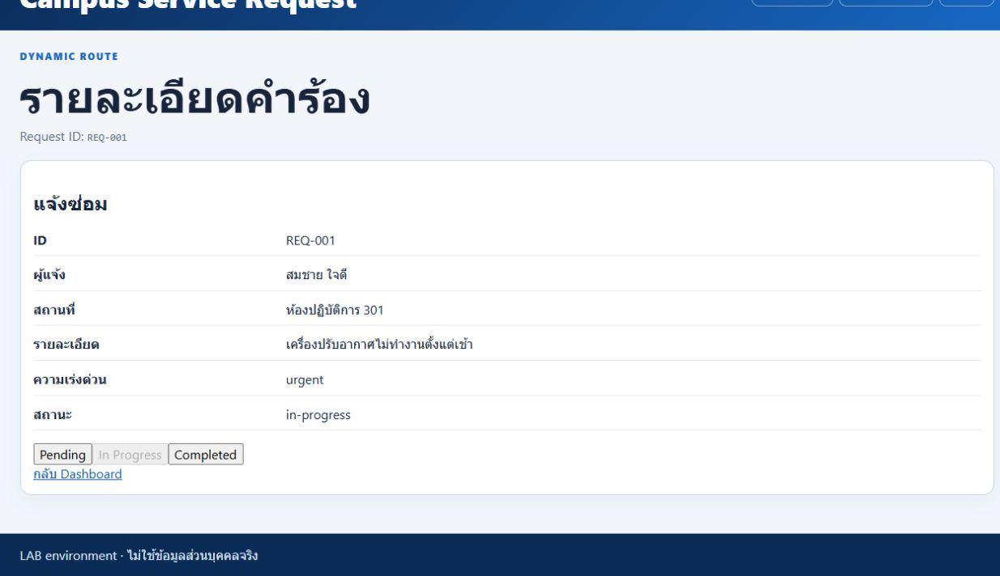
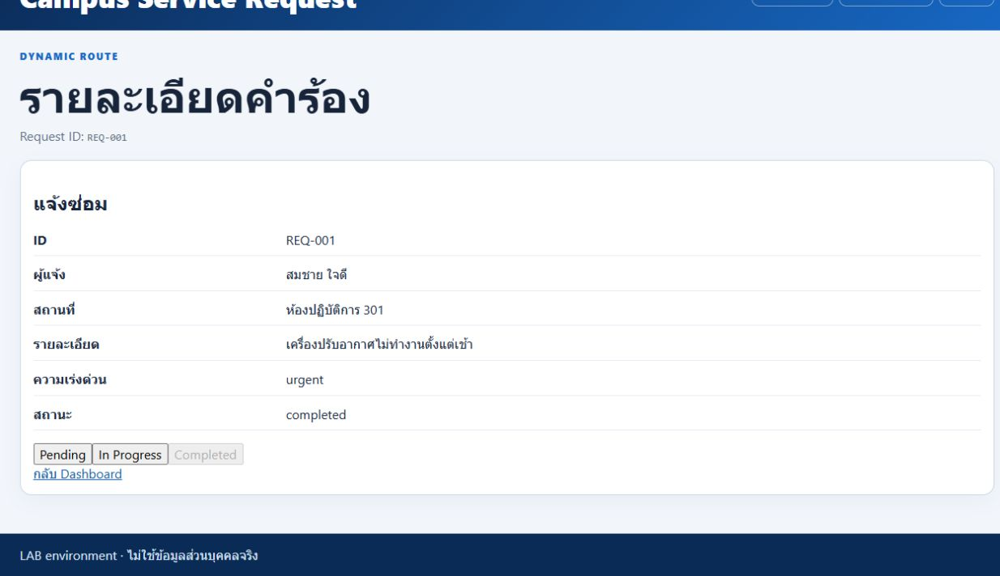
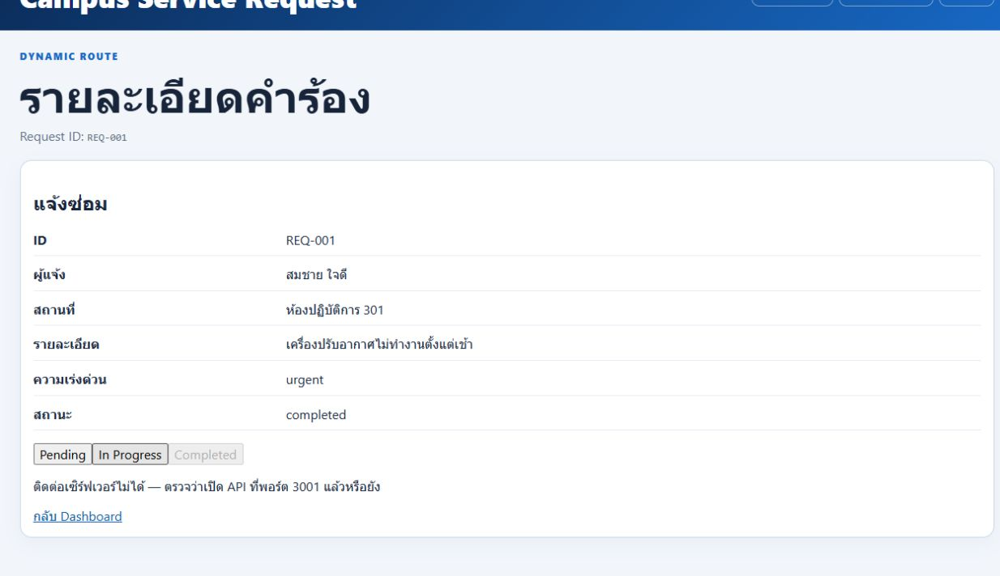

# Week 07 CP13 — R5A Regression Verification

นรบดี บุญเลิศ · 68543210013-7 · 23 ตุลาคม 2026 (Asia/Bangkok)

## Root cause และ minimal fix

ชุดหลักคือ `source/` (ชุด B) ก่อนแก้ `handleChangeStatus()` ถูกประกาศภายใน callback ของ `useEffect()` แต่ JSX เรียกจาก component scope ทำให้เกิด `ReferenceError` ก่อนเรียก service ย้ายเฉพาะ function นี้มาอยู่ภายใน `RequestDetailPage()` ระดับเดียวกับ `useEffect()` การโหลดข้อมูล/cleanup ยังอยู่ใน effect และไม่เปลี่ยน Backend, API contract, props, exports หรือ state logic

Flow: ปุ่มเรียก handler → ตั้ง updating/ล้าง error → `updateRequestStatus(request.id, nextStatus)` ส่ง PUT `/api/requests/:id` พร้อม `{ status }` → Backend ตอบ 200 พร้อม request ล่าสุด → `setRequest(updated)` แสดงข้อมูลจาก response; catch แสดง error และไม่เปลี่ยน request; finally ปลด updating ปุ่มสถานะปัจจุบันและปุ่มระหว่าง updating ยัง disabled ตามเดิม

## Behavioral regression ที่เพิ่ม

[request-detail.test.mjs](../source/frontend/tests/request-detail.test.mjs) ใช้ Node test runner, VM และ Vite JSX compiler ที่มีใน dependencies เดิม ไม่มีการติดตั้ง dependency เพิ่ม เพิ่ม script `test:cp13` เพื่อให้รันซ้ำได้

ชุดทดสอบโหลด JSX จริงแล้วเรียก callbacks จากปุ่ม ไม่ตรวจเพียงข้อความ source แต่ใช้ hooks/routing/JSX elements/services จำลองเพื่อควบคุม state และ deferred promises จึง **ไม่ใช่ React DOM test หรือ Browser E2E** การกัน request ซ้ำยืนยันว่าทุกปุ่มถูก render เป็น disabled และ click dispatcher ของ harness ไม่เรียก disabled control; ยังต้องตรวจ event/render timing ใน Browser จริง

ก่อนแก้: **2 PASS / 6 FAIL** โดยทั้ง 6 เคสล้มด้วย `ReferenceError: handleChangeStatus is not defined` หลังแก้: **8/8 PASS**

| กรณี | ผลหลังแก้ |
|---|---|
| โหลด detail ด้วย ID ถูกต้องก่อนแสดงปุ่ม | PASS |
| In Progress เรียก service ด้วย ID/status ถูกและแสดง response | PASS |
| Completed เรียก serviceและอัปเดตข้อมูล | PASS |
| สถานะปัจจุบัน disabled ไม่ส่ง update | PASS |
| ระหว่าง deferred response ทุกปุ่ม disabled ไม่ส่งซ้ำ/ไม่เปลี่ยนสถานะล่วงหน้า | PASS |
| API reject แสดงข้อความ คงสถานะเก่าและปลด updating | PASS |
| reject ที่ไม่ใช่ Error ใช้ข้อความ fallback | PASS |
| retry ล้าง error และใช้ status จาก response แม้ต่างจากค่าที่ขอ | PASS |

```powershell
# จาก Student Repository root
npm run test:cp13 --prefix labs/week-07/source/frontend
node labs/week-07/source/check-week07.mjs
npm test --prefix labs/week-07/source/api
npm run check --prefix labs/week-07/source/frontend
npm run build --prefix labs/week-07/source/frontend
```

## ผลรันจริง R5A

| คำสั่ง | ผล | Exit |
|---|---|---|
| test:cp13 ก่อน source fix | 2/8 PASS, 6 ReferenceError failures | 1 |
| test:cp13 หลัง source fix | 8/8 PASS | 0 |
| Week07 checker | Required33/33 = In-Class25/25 + Take-Home8/8; Optional1/3 รวม34/36 | 0 |
| API tests | 6/6 HTTP tests | 0 |
| Frontend check | **116/136 — FAIL** | 1 |
| Frontend build | PASS, Vite8.1.5 | 0 |

Frontend check เป็น LAB05 checker เดิมที่คาดหวัง localStorage/reset/recovery และ import service โดยตรงผ่าน Node โดยไม่มี `import.meta.env` ของ Vite จึงยังได้ผลเดิม116/136 ไม่ใช่ CP13 regression ใหม่ ไม่แก้ checker หรือ service ให้เลี่ยงข้อผิดพลาดนี้

Week07 checker ที่ผ่าน33/33ตรวจ frontend PUT service และ backend HTTP behavior แต่ไม่ยืนยันปุ่มใน Browser ด้วยตัวเอง ผล component regression แยกจาก API6/6/checker และไม่อ้างว่า mock serviceส่ง HTTPจริง

## Browser test ในรอบ R5A — UNVERIFIED (ประวัติการตรวจ)

คำสั่งเริ่ม API ชั่วคราวเพื่อทดสอบ Browser ถูก automatic approval review ปฏิเสธด้วย `blocked by policy` ก่อนเริ่ม process จึงไม่เปิด server ด้วยวิธีอื่น ไม่กดทดสอบผ่าน Browser จริง และไม่มี E2E PASS หรือ screenshot จาก R5A

### Manual procedure สำหรับ Click → PUT → Response → UI

ให้ผู้เรียนตรวจพอร์ต5317/5517ว่างก่อน หากถูกใช้ให้ตรวจเจ้าของ process ไม่ปิด process อื่นโดยเดา เปิด PowerShell แยกสองหน้าต่างที่ Student Repository root:

```powershell
# Terminal 1: Week07 API ชุด B (ข้อมูลใน memory ไม่ใช้ campus.db)
$env:PORT='5317'
$env:CORS_ORIGIN='http://localhost:5517'
$env:NODE_ENV='development'
npm start --prefix labs/week-07/source/api
```

```powershell
# Terminal 2: Frontend ชุด B
$env:VITE_API_BASE_URL='http://localhost:5317'
npm run dev --prefix labs/week-07/source/frontend -- --host localhost --port 5517 --strictPort
```

1. เปิด `http://localhost:5517/` แล้วเข้า detail ของ REQ-001 เปิด DevTools Network/Console ตรวจข้อมูลโหลดสำเร็จและไม่มี ReferenceError
2. ตรวจปุ่ม Pending disabled กด In Progress ต้องเห็น PUT `http://localhost:5317/api/requests/REQ-001`, body `{"status":"in-progress"}`, response200มีstatusเดียวกัน และUIเปลี่ยนตาม response
3. กด Completed ตรวจ PUT/body/response200/UIเช่นเดียวกัน ปุ่มCompletedต้องdisabled แล้ว refresh หน้าโดยไม่ restart API ตรวจว่าสถานะใหม่ยังอยู่ (Week07เก็บในmemoryของserver ไม่ใช่DBถาวร)
4. ใช้ Network throttling ที่เพิ่ม latency ก่อนกดปุ่มสถานะอื่น ระหว่างรอต้อง disabledทุกปุ่ม ลองกดปุ่มอื่นแล้วตรวจมี PUTเพียง1รายการ สถานะยังไม่เปลี่ยนจนได้response
5. หลังข้อมูลโหลดแล้ว หยุดเฉพาะ API ของการทดสอบใน Terminal1ด้วยCtrl+C กดปุ่มสถานะที่ต่างจากปัจจุบัน ต้องเห็น error และสถานะเก่าไม่ถูกเปลี่ยนเป็นค่าสำเร็จ ปุ่มต้องกลับมากดได้
6. เปิดAPIทดสอบใหม่ด้วยคำสั่งเดิมแล้วลองอีกครั้ง ตรวจerrorเก่าถูกล้างและUIใช้ข้อมูลresponseจริง การrestart APIจะคืนseedตามพฤติกรรมWeek07
7. เก็บ screenshotจริงที่เห็นNetwork PUT/response/UIและผลConsole แล้วจดผลแต่ละข้อ ห้ามแสดง.env/token/secret คืนNetwork throttlingเดิมและหยุดเฉพาะserverที่เปิดทดสอบ

จนกว่าจะทำขั้นตอนจริง ให้สถานะ Browser เป็น **UNVERIFIED**

## ขอบเขตและ known issues

ใช้ Codex ช่วยตรวจสาเหตุ เพิ่ม regressionแบบred/green ย้ายfunctionตามขอบเขตและรันคำสั่งข้างต้น ไม่เปลี่ยนชุด A หรือ checker, ไม่ลบduplicate, ไม่แก้LABอื่น/Week12DB/templates/GeneratedPages/dependencies/lockfiles/tags และยังไม่Stage/Commit/Push/PR/Merge/Tag

Week01/07 Terminal screenshotsยังMISSING, Week03 Zoom200ยังUNVERIFIED, Week11securityfindingยังOPEN และrootverifierยังเป็นknownissueตามรายงานR4 ไม่อ้างว่าปัญหาเหล่านี้แก้แล้วในR5A


## R6 — นำเข้าหลักฐาน Browser จริงจาก R5C

วันที่ 23 ตุลาคม 2026 ตรวจภาพจริงใน Temp ของ R5C แล้วคัดลอกโดยไม่แก้เนื้อหา ตรวจ SHA-256 ตรงต้นฉบับทั้ง 5 ไฟล์ (ภาพ 3, HTTP log 1, DOM observations 1) รอบ R6 ไม่ได้รัน Browser CP13 ใหม่ สถานะ UNVERIFIED ด้านบนเป็นประวัติรอบ R5A; รอบ R5C ได้ทดสอบ flow ด้านล่างบน Browser จริงแล้ว

ทดสอบ source ชุด B ด้วย Frontend http://localhost:5517 และ API http://localhost:5317 ใช้ REQ-001 จาก seed ของ LAB; API เก็บข้อมูลใน memory ไม่มีการใช้ campus.db ส่วนชื่อ LAB05 ใน UI และข้อความ error ที่ระบุพอร์ต3001 เป็นข้อความเดิมของ starter ไม่ได้ปรับภาพหรือแก้ source

| กรณีที่ตรวจจริง R5C | หลักฐานและขอบเขต |
|---|---|
| Pending → คลิก In Progress | ภาพแสดง in-progress และปุ่มปัจจุบัน disabled; API logger มี PUT /api/requests/REQ-001 200 |
| คลิก Completed | ภาพแสดง completed; API logger มี PUT200 ครั้งที่สอง |
| Refresh โดยไม่ restart API | DOM observation afterReload ยังคง completed; ไม่ได้เก็บภาพ refresh แยกอีกภาพ |
| หยุดเฉพาะ API ทดสอบ แล้วคลิก In Progress | ภาพแสดง error และยัง completed ไม่เปลี่ยนเป็นสถานะสำเร็จ |
| UI ใช้ข้อมูลจาก response | Browser แสดงสถานะสอดคล้องกับ backend GET ที่ตรวจแยก; regression8/8 ตรวจ setRequest(updated) รวมกรณี response ต่างจากค่าที่ขอ ไม่ได้จับ raw PUT response บน Network panel |
| Browser Network panel แสดง PUT/body/response | **MISSING** ไม่มี screenshot/HAR ของ Network panel; HTTP200 ยืนยันจาก API logger จริงด้านล่าง ห้ามใช้แทนภาพ Network |
| latency / double click ระหว่าง request | **UNVERIFIED บน Browser**; harness regression ตรวจ updating/disabled ได้ แต่ไม่แทน timing จริง |

### ภาพจริงที่คัดลอก







[HTTP log จริงจาก API ในรอบ R5C](cp13-api-http-r5c.txt) มี PUT200 สองรายการ ส่วน GET ใน log เป็นคนละ request ไม่ใช่ raw PUT response

[Browser DOM observations จาก R5C](cp13-browser-observations-r5c.json) บันทึก before / inProgress / completed / afterReload / apiUnavailable ไม่ใช่ Network capture

### Terminal evidence ที่ยังขาด

images/terminal-api.png ยัง **MISSING** (ตรวจ R6) HTTP log แบบข้อความและภาพ UI ข้างต้นไม่ใช่ภาพ Terminal ให้เปิด API ชุด B จริงใน PowerShell และส่ง GET แล้วถ่ายภาพหน้าต่าง Terminal ที่มี HTTP log โดยไม่เปิดเผย environment values

labs/week-01/evidence/terminal-run.png ยัง **MISSING** เช่นกัน ไม่สร้างภาพ Terminal จำลอง ทั้งสองรายการต้องมีภาพจริงก่อนระบุว่า evidence ครบ

LAB05 legacy checker ยัง 116/136, exit1 การจำแนก R5B คงเดิม: 11 LAB05-specific, 9 Week07-relevant ที่ static/import harness ยังตรวจไม่ได้โดยตรง; service probe12/12 ไม่พบ defect ใหม่ในขอบเขตที่ตรวจ ไม่แก้ checker หรือย้อน service ไปใช้ localStorage
