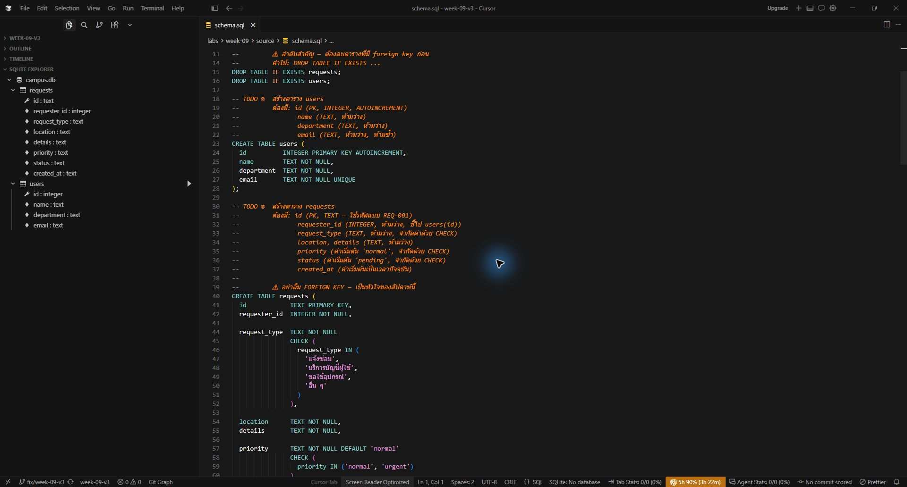
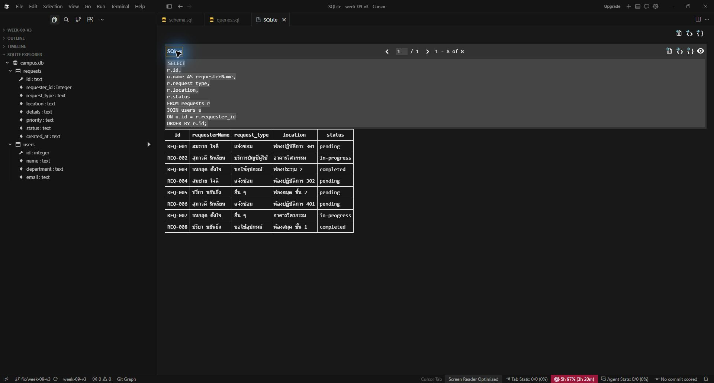

# Week09 — Post-audit evidence verification

24 ตุลาคม 2026 (Asia/Bangkok) · Draft revision v3

## Requirement interpretation

Instructor pin: `3e080d366483fe9b4a903d9f4dd318b5de4cd5dd`.

- [Take-Home Guide lines372–377](https://github.com/se-rmutl/engse203-lab/blob/3e080d366483fe9b4a903d9f4dd318b5de4cd5dd/labs/week-09-sql-fundamentals/lab09/LAB09_TAKEHOME_GUIDE_TH.md#L372) explicitly labels the two screenshots “Screenshot ที่ต้องมี”: `schema-in-vscode.png` and `join-result.png`. They are **Mandatory**, not optional challenges.
- The same guide permits CP25 constraint results in `CONSTRAINT_TEST.md` **or as a section of DATA_MODEL.md**. The existing DATA_MODEL.md does satisfy that text-evidence location option. This exception does not waive the two screenshots.
- In-Class/README/checker coverage of SQL is distinct from these submission screenshots; checker27/27 alone does not prove screenshot completion.

## Fresh execution

From Student Repository root:

```powershell
node --disable-warning=ExperimentalWarning labs/week-09/evidence/verify-sql.mjs
```

Actual output: [post-audit-sql-results.json](post-audit-sql-results.json).

- PASS: submitted `campus.db` opened read-only; users4/requests8; SQLite integrityok; no foreign-key violations; DB SHA256 unchanged.
- PASS: all8 statements in submitted queries.sql returned the expected results, including JOIN with requesterName.
- PASS: schema ran twice in memory without error.
- PASS: all5 constraint attempts were rejected with the actual database error: foreign key, status CHECK, email UNIQUE, duplicate primary key, missing location NOT NULL.
- PASS: unmodified supplied checker executed on a separate copy:11/11 in-class +16/16 take-home =27/27 required; optional0/3.

No submitted schema/query/database or instructor checker was changed. Constraint attempts use SAVEPOINT/ROLLBACK on a memory database, never the submitted file.

## Screenshot status — PASS (native GUI followup, 2026-10-24)

| File | Current status | Actual captured content |
|---|---|---|
| [images/schema-in-vscode.png](images/schema-in-vscode.png) | **PASS** | Real Cursor IDE + installed SQLite extension, actual submitted campus.db opened, requests/users expanded with all columns; original schema.sql viewed alongside, not executed |
| [images/join-result.png](images/join-result.png) | **PASS** | Actual query5 SELECT/JOIN from submitted queries.sql lines34–43, executed with SQLite: Run Selected Query; expanded executed SQL and real result grid show requesterName plus REQ-001…REQ-008,8 rows |

The initial native attempt was blocked by inconsistent window capture. A fresh permitted CUA attempt succeeded after selecting the real IDE separately from Cursor Agents, using actual screenshots/keyboard navigation and the installed SQLite extension. These are native captures, not generated editor imitations. No manual screenshot remains required.

The raw tool screenshots are JPEG. They were converted to PNG without resizing, cropping, annotations, composition or generated content; decoded RGB pixels were compared equal. [GUI_SCREENSHOT_PROVENANCE.json](GUI_SCREENSHOT_PROVENANCE.json) records timestamps, extension, DB path, selected lines, original-JPEG/PNG hashes and dimensions. The submitted DB SHA256 before/after is identical: `993a960915978c60a16b07504e59413912ed9596f5de0328f94b9aa3844135e3`. No schema.sql execution or DB writes occurred.

## GUI reproduction

1. Open this revision worktree in Cursor and run SQLite: Open Database; choose labs/week-09/source/campus.db.
2. Expand SQLite Explorer → campus.db → requests and users. View the unchanged schema.sql without executing it.
3. Open the unchanged queries.sql; select only lines34–43 (query5,166 characters), then SQLite: Run Selected Query; choose the same LAB09 DB.
4. Expand the result view SQL header; verify the actual JOIN, requesterName and8 result rows. This is how the committed captures were obtained.

The two mandatory screenshot gaps are now closed. This evidence does not create a new learner attestation or authorize merge/tag.

## References & AI Assistance

Codex checked the pinned submission requirements, added the read-only/memory verification script, recorded actual output, and captured both mandatory screenshots through the real editor and SQLite extension. The learner still needs to explain JOIN and the five constraints from the submitted SQL; no manual screenshot remains required.

## Captured evidence




